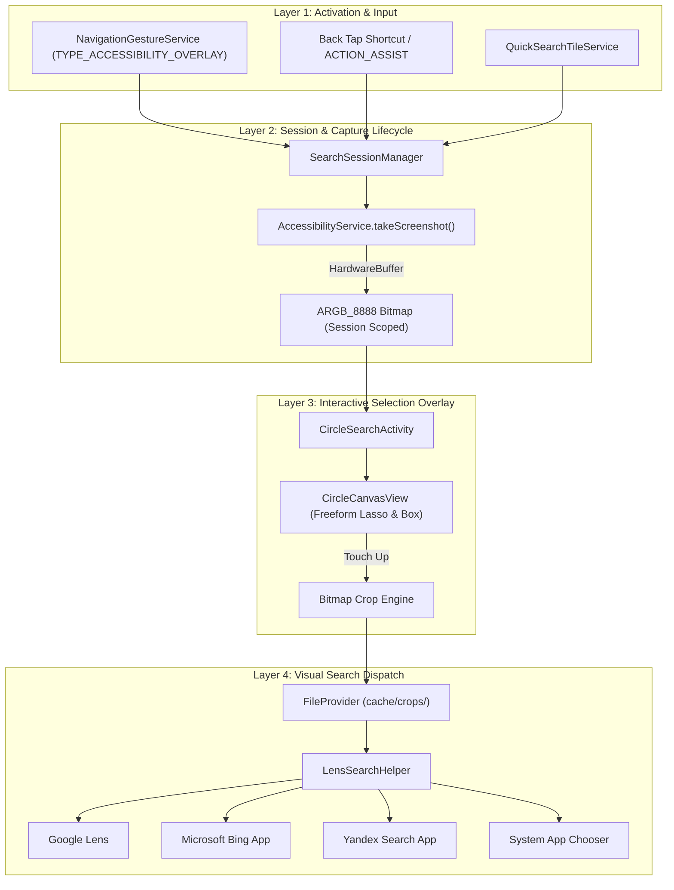

# System Architecture: Shovo Circle Search

**Target Platform:** Xiaomi 13 (HyperOS 3 / Android 16)  
**Package:** `dev.shovo.circlesearch`  

---

## 1. Architectural Layers

---

## 2. Key Subsystems
1. **`NavigationGestureService`:** Manages the transparent overlay pill (160dp × 24dp) at `y = 0`. Detects stationary hold while letting swipe navigation pass without synthetic injection.
2. **`SearchSessionManager`:** Thread-safe singleton providing unique session IDs, strict bitmap ownership, and automatic memory cleanup.
3. **`CircleSearchActivity` & `CircleCanvasView`:** Edge-to-edge transparent activity displaying the captured frame, supporting dynamic multi-touch gestures, display cutouts, and haptic feedback.
4. **`LensSearchHelper`:** Crops selected bounds, writes JPEG to private cache, generates FileProvider URI with temporary read permissions, and dispatches to the selected visual engine.
