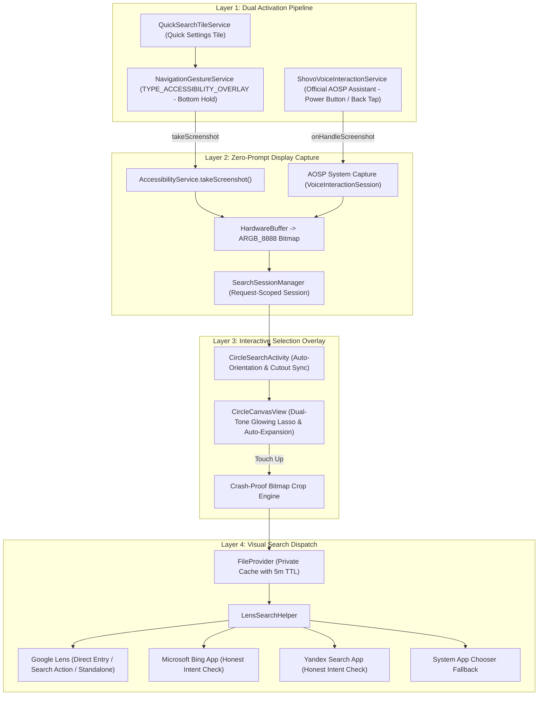

# System Architecture: Circle to Search for Xiaomi

**Target Platform:** Xiaomi 13 (HyperOS 3 / Android 16)  
**Package:** `dev.shovo.circlesearch`  

---

## 1. Architectural Layers

---

## 2. Key Subsystems
1. **`ShovoVoiceInteractionService` & `ShovoVoiceSession` (Official Assistant):** Registers Circle to Search for Xiaomi as an official Android Digital Assistant, delivering zero-latency system screenshots via `onHandleScreenshot` without accessibility service permissions.
2. **`NavigationGestureService` (Accessibility Overlay):** Manages the calibrated 160dp × 24dp transparent pill at screen bottom. Detects stationary long press and delegates upward swipes to Home and Recents.
3. **`SearchSessionManager`:** Thread-safe singleton providing unique session IDs, strict bitmap ownership, and automatic memory cleanup.
4. **`CircleSearchActivity` & `CircleCanvasView`:** Edge-to-edge transparent activity with dynamic landscape/portrait synchronization, cutout avoidance, Material 3 close button, and dual-tone glowing stroke.
5. **`LensSearchHelper`:** Crops selected bounds with memory bounds safety, writes JPEG to private cache, and dispatches to Google Lens, Bing, Yandex, or System Chooser.
