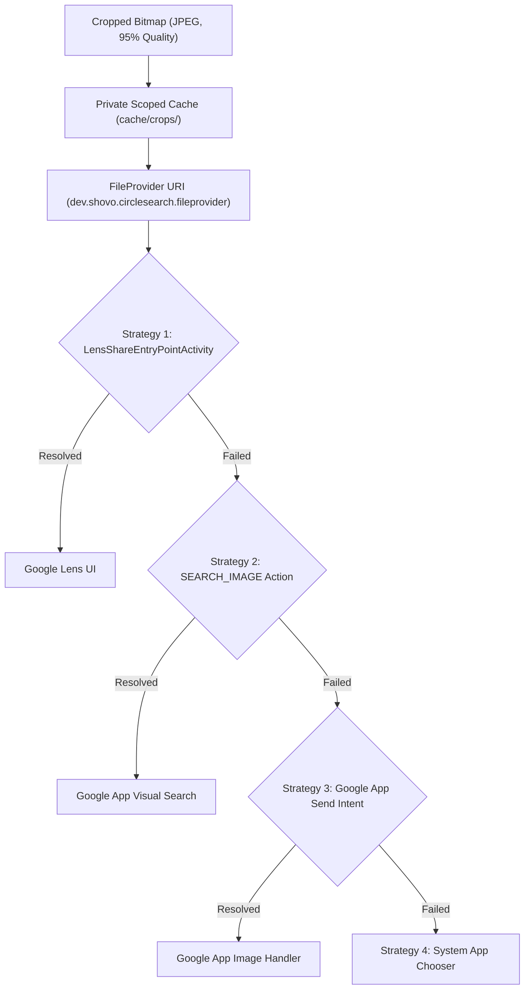

# Google Circle to Search & Lens Integration Architecture

**Component:** `dev.shovo.circlesearch.LensSearchHelper`  
**Compatibility Layer:** Multi-strategy Google App & Google Photos Intent Dispatcher  

---

## 1. Native Omni Entry Point Investigation
- **The Omni Mechanism:** Google's proprietary Circle to Search implementation is backed by internal GMS flag `45631784` and `com.google.android.googlequicksearchbox.omni.entry_point`.
- **Hardware Whitelist Reality:** On non-Pixel and non-Samsung devices (such as Xiaomi 13 China ROM), GMS rejects unrooted Omni Binder invocations (`Omni invocation failed: not enabled`).
- **Zero-Root Engineering Decision:** Rather than requiring LSPosed hooks to spoof Pixel device profiles, Shovo Circle Search implements a **guarded compatibility adapter** targeting Google Lens's high-speed image processing pipelines.

---

## 2. Dispatch Pipeline Strategies

---

## 3. Intent Security & Permissions
- All Google intents include `FLAG_GRANT_READ_URI_PERMISSION`.
- Exact clip data attached via `ClipData.newRawUri("image", imageUri)` ensuring Android 16 Scoped Storage compliance.
- Android Manifest declares `<queries>` for `com.google.android.googlequicksearchbox` and `com.google.android.apps.photos` to bypass HyperOS package filtering.
