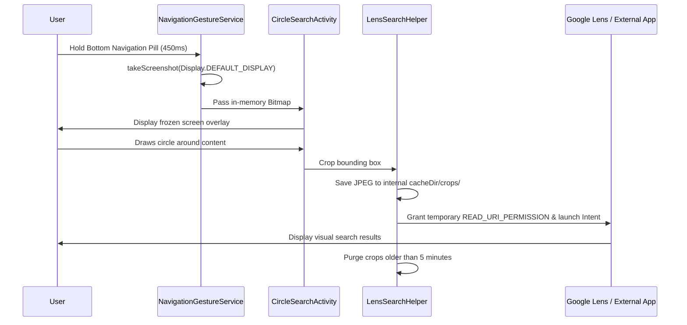

# Privacy Architecture and Data Flow Analysis

## 1. Zero Cloud Dependency for Selection
The application never transmits user screenshots to any cloud service, third-party analytics provider, or external server. All screenshot capture, display, coordinate mapping, and image cropping are executed 100% on-device in local memory.

---

## 2. Data Flow Diagram

---

## 3. Data Retention Policy
- Screenshots in memory: Recycled immediately when `CircleSearchActivity` is destroyed.
- Cropped files on disk: Saved to `Context.cacheDir/crops/`. Evaluated on every run and deleted if timestamp > 300 seconds.
- User search queries: Never logged or stored.

